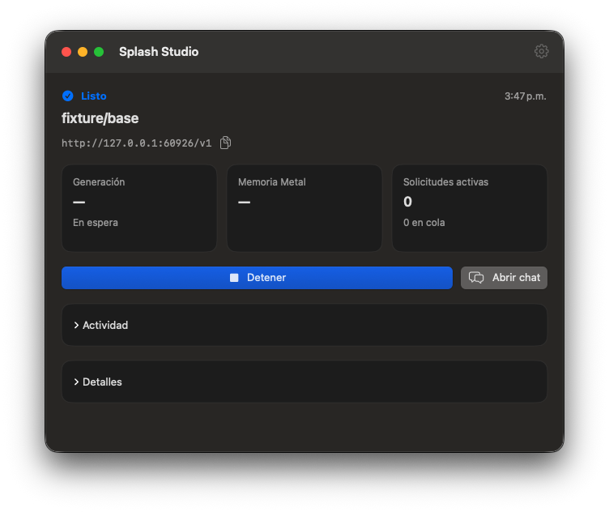
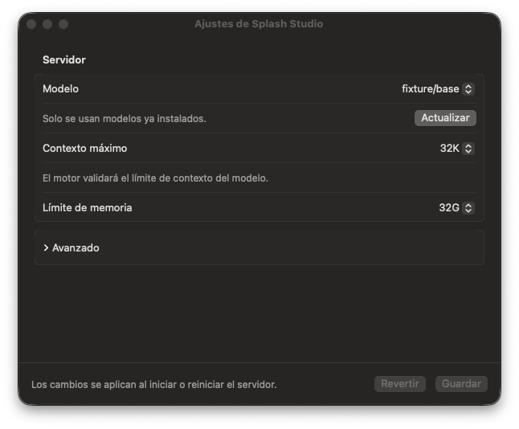
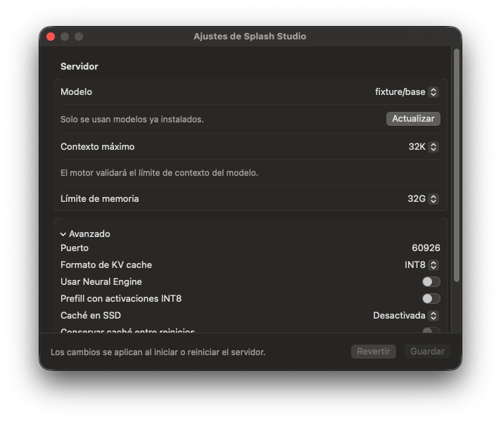

# Studio validation — October 24, 2026

Validated on Apple silicon with macOS 27.0.1. This work changes the Studio
control panel; model weights, pruning, training and native inference kernels
are outside the Studio diff.

## Automated checks

`swift test` passed **35 tests with zero failures** in 32.306 seconds:

- 22 configuration/status checks: atomic persistence and reload, per-field
  migration, malformed-file preservation, invalid settings, schema handling,
  unavailable versus zero metrics, overlapping KV page ownership, memory units,
  explicit health failures, and stable log-row identity.
- 13 lifecycle checks: owned start/stop and idle restart; preflight rejection
  preserving a healthy instance; startup cancellation; configured-port adoption
  and polling; external disconnect; stale replies; memory release and refusal;
  orphan cleanup and retry; neighboring-process isolation; verified CLI stop;
  and initial versus post-start readiness/health failures.

All servers in these checks are standard-library Python fixtures in temporary
directories. Their prepared-model directories contain metadata only, and the
fake native executable is never used for inference. Each owned fixture has a
private log path. The normal user settings and engine logs are not test inputs
for mutation.

## Application checks

The release build and local app-bundle creation passed. The bundle's ad hoc
signature passed `codesign --verify --deep --strict`; `Info.plist` passed
`plutil -lint`.

The final app was also exercised against an isolated local fixture profile:

- The main window fits at 640 × 520 points.
- Native Settings opens with the keyboard shortcut and stays 600 points wide.
- Advanced controls expand and scroll while the save footer remains visible.
- Closing all windows keeps the app available; Show Window reopens the summary.
- Disconnect leaves an external server running.
- Explicit CLI shutdown stops the verified fixture server.
- Start from the GUI creates an owned fixture process.
- Quit waits for that process to exit; its PID and listener were confirmed gone.

The fixture and review app were stopped after validation. No model was loaded,
downloaded, duplicated, trained or modified. These checks do not measure
inference throughput or model quality.

## Captured interface

These captures show the actual compiled app connected to `fixture/base`, a
local validation server. Missing inference metrics intentionally display dashes.

### Summary

### Settings

### Advanced settings

[Machine-readable validation summary](validation-2026-10-24.json) includes the
commands, results and hashes of the external full logs. Generated application
bundles and build artifacts remain in the ignored `.build` directory.
